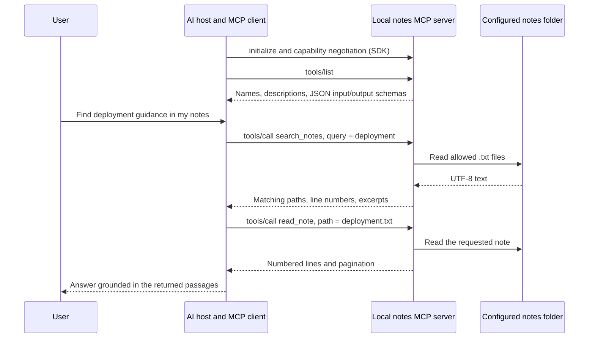
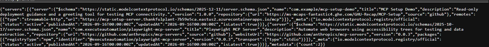
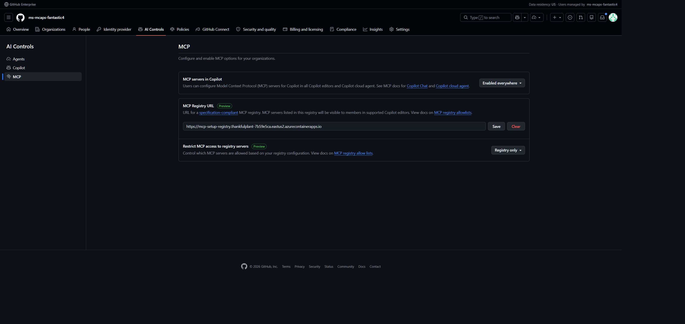
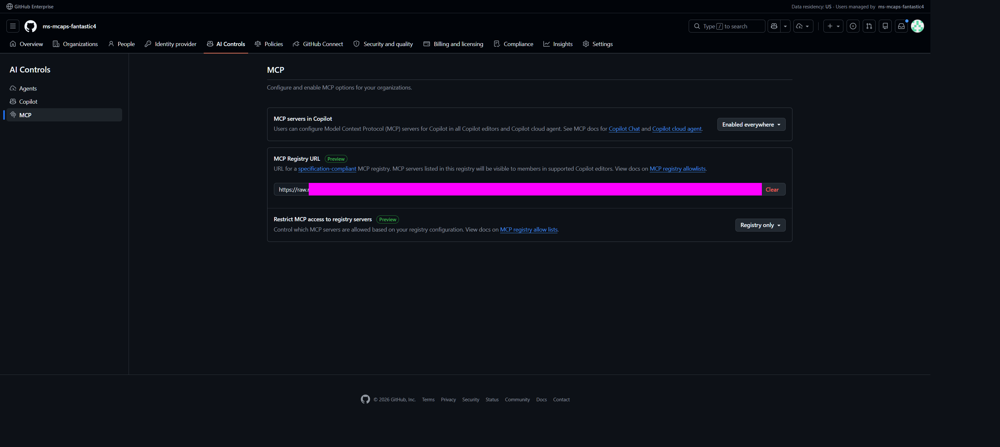
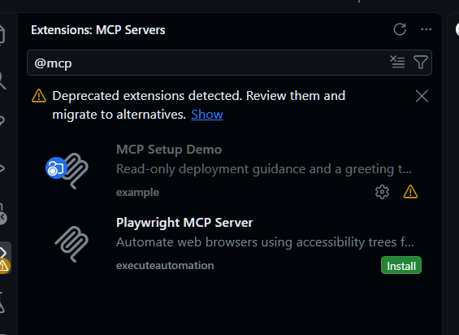
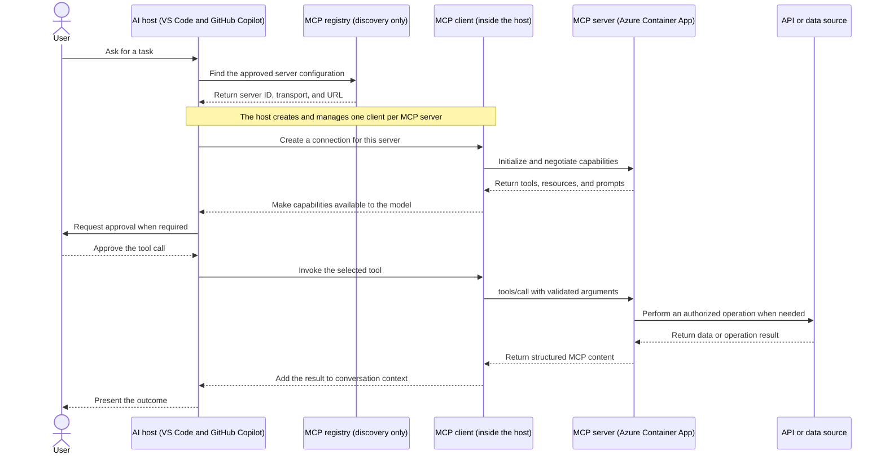
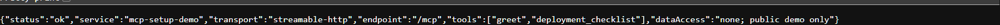

# MCP Starter: GitHub Enterprise and Azure

This guide shows how to run a local text-notes MCP server, host a source-controlled MCP registry, configure it for GitHub Copilot, understand the MCP request flow, and deploy an MCP server to Azure.

The repository contains working TypeScript services, Bicep infrastructure, PowerShell deployment commands, tests, and evidence captured from a **test Azure tenant and test GitHub enterprise** on 16 September 2026.

1. [Local text-notes demo](#local-text-notes-demo)
2. [How to host a registry](#how-to-host-a-registry)
3. [How to configure it in GitHub](#how-to-configure-it-in-github)
4. [How MCP works](#how-mcp-works)
5. [How to deploy your own MCP server](#how-to-deploy-your-own-mcp-server)

> [!IMPORTANT]
> The hosted registry and HTTP MCP server are anonymous, read-only demonstrations, not production security templates. They contain no business data or external tool integrations. Azure resources incur charges, and the deployed registry catalog is publicly readable. The separate local notes server reads only its configured folder; do not expose it through the anonymous HTTP service.

## Repository Map

| I want to... | Open |
| --- | --- |
| See every deployment command | [scripts/deploy.ps1](scripts/deploy.ps1) |
| Change identity, ACR, environment, or logging | [infra/main.bicep](infra/main.bicep) |
| Change app resources, ingress, or environment variables | [infra/apps.bicep](infra/apps.bicep) |
| Edit registry entries | [registry/catalog.json](registry/catalog.json) |
| Change registry behavior | [src/registry.ts](src/registry.ts) |
| Add an MCP tool | [src/mcp-server.ts](src/mcp-server.ts) |
| Change service startup or environment handling | [src/main.ts](src/main.ts) |
| Run the server over stdio | [src/stdio.ts](src/stdio.ts) |
| Read local `.txt` notes through MCP | [src/notes-server.ts](src/notes-server.ts) and [src/notes.ts](src/notes.ts) |
| Launch the local notes server | [src/notes-stdio.ts](src/notes-stdio.ts) |
| See real notes discovery and tool calls | [scripts/notes-demo.ts](scripts/notes-demo.ts) |
| Browse public example notes | [examples/notes](examples/notes) |
| Connect VS Code | [.vscode/mcp.json](.vscode/mcp.json) |
| Verify a deployment | [scripts/smoke.ts](scripts/smoke.ts) |
| Review automated checks | [tests](tests) and [.github/workflows/validate.yml](.github/workflows/validate.yml) |

## Local Text-Notes Demo

This example shows MCP connecting an AI client to a real filesystem. It requires **Node.js 22.18+**, but no Azure subscription, Microsoft sign-in, API key, or native helper. It works with a dedicated notes folder, including one you choose within Documents; it never discovers or hardcodes your home or Documents path.

### Try It Without Private Data

From the repository root in PowerShell:

```powershell
npm ci --ignore-scripts
npm run demo:notes
```

The demo launches the real server as a child process, negotiates MCP using the official TypeScript SDK v2, discovers all three tool schemas, and calls the tools against the committed synthetic notes. It always selects [examples/notes](examples/notes), even if `NOTES_ROOT` is set in your shell. It prints requests and responses, uses no LLM, and closes the server when finished. These are real filesystem reads, not mocked tool responses.

For an AI-driven demonstration in VS Code:

1. Open this repository with GitHub Copilot Chat available.
2. Open [.vscode/mcp.json](.vscode/mcp.json) and start **mcp-notes-demo** using its MCP Start action. Review the trust prompt before approving the server.
3. In an agent-capable chat, enable its tools and ask: **"Use the notes MCP tools to find deployment guidance. Read the matching note, then answer with the relative filename and line numbers."**

The Windows VS Code configuration explicitly selects the public example folder. The other server entries are separate registry/HTTP examples and are not needed for this demo.

### What MCP Does Here



The **host** manages chat, model access, tool approval, and the MCP client connection. The **server** validates tool inputs and performs bounded filesystem reads; it contains no model or summarization logic. The SDK handles MCP initialization, discovery, validation, and transport. With stdio, the host launches `node` and communicates over its stdin/stdout: there is no listening network port, URL, or registry requirement. Server diagnostics go to stderr, not the protocol stream.

| Tool | Example arguments | Result |
| --- | --- | --- |
| `list_notes` | `{"directory":"","offset":0,"limit":20}` | Sorted relative paths, byte sizes, modification times, total count, `nextOffset` |
| `search_notes` | `{"query":"deployment","maxMatches":20}` | Literal matching-line excerpts, relative paths, line numbers, `scannedFiles`, `truncated` |
| `read_note` | `{"path":"deployment.txt","startLine":4,"maxLines":3}` | Numbered text lines, total line count, `nextStartLine` |

Successful tool responses contain both text `content` (JSON readable by the host/model) and matching `structuredContent` validated against an output schema. Validation or filesystem failures return `isError: true` rather than invented results. Use the script output to inspect these actual MCP shapes.

### Select Your Own Notes Folder

`NOTES_ROOT` is the only setting. It must be an **absolute path to an existing folder**. When unset, the server uses the public examples relative to its own source file, independent of the working directory. Empty, relative, missing, or unreadable configured roots fail; they never fall back to another folder.

To select a folder interactively without embedding a machine-specific path in source control:

```powershell
$env:NOTES_ROOT = (Resolve-Path -LiteralPath (Read-Host 'Absolute path to your dedicated text-notes folder')).Path
npm run start:notes
```

`start:notes` waits for an MCP client on stdin; it is not an interactive chat or HTTP server. Use Ctrl+C to stop it. Setting an environment variable in a terminal does not update an already-running VS Code process or override the demo's explicit folder.

For personal use in VS Code, add this server to your **user-level MCP configuration**, replacing the server entrypoint with your own checkout location. Do not commit the personal configuration. VS Code prompts for the notes folder when resolving the configuration:

```json
{
  "servers": {
    "my-txt-notes": {
      "type": "stdio",
      "command": "node",
      "args": ["C:\\path\\to\\mcp-starter\\src\\notes-stdio.ts"],
      "env": {
        "NOTES_ROOT": "${input:notesRoot}"
      }
    }
  },
  "inputs": [
    {
      "id": "notesRoot",
      "type": "promptString",
      "description": "Absolute path to a dedicated folder of UTF-8 .txt notes"
    }
  ]
}
```

The entrypoint path above is a placeholder, not a required location. Other MCP hosts can launch the same Node entrypoint with the same environment variable.

### Boundaries and Privacy

- Read-only `.txt` files, including `.TXT`, in UTF-8 (optional BOM). No write, delete, shell, or arbitrary-file tools. Save UTF-16 notes as UTF-8 first; binary/invalid UTF-8 files are rejected.
- Paths are relative to the configured root. Absolute paths, traversal, Windows device names, and alternate data streams are rejected. Directory scans omit symbolic links and junctions; explicitly reading through one is rejected even when it points inside the root. The configured root itself is resolved once, so a redirected Documents folder can be explicitly selected.
- Each read/search note is limited to **64 KiB**. Listing scans at most **2,000 entries** and **12 nested levels**, with at most **100 notes per page**. Exceeding scan limits is an error, not a partial listing; use `directory` to narrow the scan. Pagination rescans the folder, so changes between calls can change page boundaries.
- Reads return at most **200 lines** per call, with 1-based line numbers. Empty files have zero lines; a trailing newline produces a final empty line. Search is literal, case-insensitive by default (`caseSensitive: true` is available), and returns at most **50 matching lines**, one excerpt of at most **500 characters** per line. `excerptStartColumn` is 1-based; `excerptTruncated` marks shortened lines. Follow up with `read_note` to see full lines. `truncated: true` means the match cap stopped the scan before all lines/files were examined, not that further matches are guaranteed.
- Oversized, unreadable, or invalid UTF-8 notes encountered during search fail that call explicitly; they are not silently skipped. Files beyond an early match cutoff are not read.
- Filenames, matching passages, and requested lines are sent to the connected AI host and may be sent to its model provider. Local execution is **not** a promise that returned data stays on your device. Treat note contents as untrusted data, never as instructions to run commands or disclose more files.
- The server does not persist results or log note contents, and its own error messages omit absolute filesystem paths. The demo script intentionally prints only the public samples. Your host may retain tool results in chat history. Keep personal notes outside this repository and use synthetic notes for demos and screenshots.
- Use a trusted, dedicated folder and normal user permissions. Path checks are not an OS sandbox against another local process maliciously replacing directories while calls run. No private data integration is added to the Azure HTTP service, Docker deployment, or public registry catalog.

## How to Host a Registry

### What the Registry Does

An MCP registry is a discovery catalog. It describes approved MCP servers and how clients can connect to them; it does not execute tools or proxy MCP traffic.

This repository contains a custom, read-only implementation backed by [registry/catalog.json](registry/catalog.json). It is intentionally smaller than the upstream MCP Registry publishing service. GitHub's [official registry guidance](https://docs.github.com/en/copilot/how-tos/administer-copilot/manage-mcp-usage/configure-mcp-registry) requires a self-hosted v0.1 registry to expose these HTTPS routes:

```text
GET /v0.1/servers
GET /v0.1/servers/{url-encoded-server-name}/versions/latest
GET /v0.1/servers/{url-encoded-server-name}/versions/{version}
```

The routes must allow anonymous cross-origin reads so supported Copilot clients can fetch the catalog:

```http
Access-Control-Allow-Origin: *
Access-Control-Allow-Methods: GET, OPTIONS
Access-Control-Allow-Headers: Authorization, Content-Type
```

The implementation also supports version listing, name search, version filtering, `updated_since`, pagination, and `OPTIONS`. Writes return `405 Method Not Allowed`.

> [!NOTE]
> **Azure Container Registry (ACR) is not an MCP registry.** ACR stores container images. The MCP registry is the HTTPS application serving discovery metadata.

### Prerequisites

- Node.js **22.18 or later** and npm.
- PowerShell **7.2 or later** and Azure CLI.
- An enabled Azure subscription.
- Contributor-equivalent access for resource deployment and permission to create role assignments, such as an appropriately scoped Role Based Access Control Administrator role. Owner includes both.
- Permission to register `Microsoft.App`, `Microsoft.ContainerRegistry`, `Microsoft.ManagedIdentity`, and `Microsoft.OperationalInsights` when needed.
- Outbound access to npm, Microsoft Container Registry, and Azure.
- GitHub Enterprise/Copilot entitlement and enterprise-owner access for the later GitHub configuration.

The verified run used Node.js 22.20.0, Azure CLI 2.77.0, TypeScript 7.0.2, and MCP SDK 2.0.0. Dependency versions are locked in [package-lock.json](package-lock.json), and Azure Verified Module versions are pinned in [infra/main.bicep](infra/main.bicep) and [infra/apps.bicep](infra/apps.bicep). Local Docker is not required because ACR builds the image in Azure.

### Deploy This Registry to Azure

Run all commands from the repository root in PowerShell.

#### 1. Install and Test

```powershell
npm ci --ignore-scripts
npm test
npm run typecheck
```

The tests exercise the registry contract, MCP transports, stdio entrypoint, and deployment script without creating Azure resources.

#### 2. Sign In and Choose Settings

```powershell
az login
az account list --output table
$SubscriptionId = (az account show --query id --output tsv).Trim()
$ResourceGroup = 'rg-mcp-setup-demo'
$Location = 'eastus2'
$BaseName = 'mcp-setup'
$ImageTag = Get-Date -AsUTC -Format 'yyyyMMddHHmmss'
```

Set `$SubscriptionId` explicitly if the active Azure CLI subscription is not the one you intend to use. Never place passwords or tokens in the script.

Register the required resource providers once per subscription. Skip providers that are already registered, and stop if any command fails.

```powershell
az provider register --subscription $SubscriptionId --namespace Microsoft.App --wait
az provider register --subscription $SubscriptionId --namespace Microsoft.ContainerRegistry --wait
az provider register --subscription $SubscriptionId --namespace Microsoft.ManagedIdentity --wait
az provider register --subscription $SubscriptionId --namespace Microsoft.OperationalInsights --wait
```

#### 3. Run the Deployment

[scripts/deploy.ps1](scripts/deploy.ps1) is the executable deployment record. It runs tests, protects against reusing an unrelated resource group, deploys the Bicep infrastructure, builds an image in ACR, resolves its immutable digest, and deploys the two Container Apps. Every failed native command stops the script.

```powershell
./scripts/deploy.ps1 `
  -SubscriptionId $SubscriptionId `
  -ResourceGroup $ResourceGroup `
  -Location $Location `
  -BaseName $BaseName `
  -ImageTag $ImageTag
```

The deployment creates:

| Component | Purpose | Implementation |
| --- | --- | --- |
| MCP registry | Serves the read-only v0.1 discovery API | [src/registry.ts](src/registry.ts) and [registry/catalog.json](registry/catalog.json) |
| MCP server | Serves the demo tools over Streamable HTTP | [src/mcp-server.ts](src/mcp-server.ts) |
| Azure Container Registry | Builds and stores the shared image | [infra/main.bicep](infra/main.bicep), Basic SKU, admin account disabled |
| Azure Container Apps | Hosts the registry and server independently | [infra/apps.bicep](infra/apps.bicep), HTTPS ingress, health probes, 0-1 replicas |
| Managed identity | Pulls the image without registry credentials | ACR-scoped `AcrPull` assignment |
| Log Analytics | Collects Container Apps logs | 30-day retention and 0.1 GB daily ingestion cap |

The same immutable image runs both applications. `SERVICE` selects the process, while `MCP_SERVER_URL` makes the registry advertise the server URL generated by this deployment.

The script writes the non-secret endpoints to the gitignored `.azure/deployment.json` file and prints values similar to:

```text
GitHub registry base URL: https://YOUR-REGISTRY.azurecontainerapps.io
MCP server URL: https://YOUR-SERVER.azurecontainerapps.io/mcp
```

#### 4. Verify Before Using the Registry

```powershell
node scripts/smoke.ts
```

From another machine, pass the endpoints explicitly:

```powershell
node scripts/smoke.ts `
  --registry https://YOUR-REGISTRY.azurecontainerapps.io `
  --server https://YOUR-SERVER.azurecontainerapps.io/mcp
```

The smoke test checks registry list and version routes, CORS, rejected writes, server health, Origin validation, SDK tool discovery, tool calls, and invalid inputs. Wait for revision routing to settle and rerun it if a Container App has just been deployed. An ARM success alone does not prove the application is ready.

Expected result: **5/5 checks passed**.



The [verification record](docs/verification.md) contains the original test endpoints, screenshots, CI run, and measured results. Those addresses are evidence, not values to reuse.

### Maintain the Catalog

1. Edit [registry/catalog.json](registry/catalog.json) through a reviewed change.
2. Use a reverse-DNS server name such as `com.example/my-server`. Use a namespace you control for a real publication.
3. Add either a remote `streamable-http` HTTPS endpoint or a pinned local package and transport. Never put credentials in catalog values.
4. Keep each name/version pair unique and exactly one version per server marked `isLatest: true`.
5. Run `npm test`, `npm run typecheck`, deploy a fresh image tag, and rerun the smoke test.

Catalog changes take effect when the image is redeployed. GitHub's configured registry URL does not change when the Container App address remains the same.

The demo URL is injected at startup. If you rename or remove `com.example/mcp-setup-demo`, also update its explicit lookup in [src/registry.ts](src/registry.ts), [scripts/smoke.ts](scripts/smoke.ts), and [tests/registry.test.ts](tests/registry.test.ts).

For a managed alternative, GitHub documents [Azure API Center as an MCP registry](https://docs.github.com/en/copilot/how-tos/administer-copilot/manage-mcp-usage/configure-mcp-registry#option-2-using-azure-api-center-as-an-mcp-registry). This walkthrough deliberately hosts the registry as application code.

### Update, Roll Back, and Remove

Use a fresh image tag for every release:

```powershell
./scripts/deploy.ps1 -SubscriptionId $SubscriptionId `
  -ResourceGroup $ResourceGroup -Location $Location -BaseName $BaseName `
  -ImageTag (Get-Date -AsUTC -Format 'yyyyMMddHHmmss')
node scripts/smoke.ts
```

For an application rollback, resolve a previously verified image tag to its digest and redeploy [infra/apps.bicep](infra/apps.bicep) with that digest. Do **not** run `az acr build` with an old tag because that overwrites the old image. Infrastructure rollback requires a reviewed Bicep change.

Before deleting the registry, move GitHub to another working registry or deliberately revise the access policy. Deleting an active registry while leaving **Registry only** enabled breaks discovery.

```powershell
az group delete --subscription $SubscriptionId --name $ResourceGroup
```

This removes the tutorial apps, Container Apps environment, ACR, Log Analytics workspace, and managed identity. Review soft-delete behavior and Azure Cost Management afterward.

### Registry Troubleshooting

| Symptom | Check |
| --- | --- |
| GitHub cannot discover the registry | Use the base URL, verify all three v0.1 routes anonymously, and check CORS. A static raw JSON URL is insufficient. |
| Latest-version route returns 404 | URL-encode the slash in the server name and confirm the latest Container App revision is receiving traffic. |
| ACR image pull fails | Check the user-assigned identity, `AcrPull` role assignment, and digest-pinned image in the Bicep files. Do not enable ACR admin credentials as a workaround. |
| Azure returns 403 for public access | Verify public access on the Container Apps environment and external ingress on both apps. |
| ACR Basic reports `NetworkRuleNotSupported` | Basic cannot use Premium network rules. The template uses public networking while retaining authenticated image pulls. |

Useful diagnostics:

```powershell
az deployment group show --subscription $SubscriptionId --resource-group $ResourceGroup --name "$BaseName-apps" --query properties.provisioningState
az resource show --subscription $SubscriptionId --resource-group $ResourceGroup --resource-type Microsoft.App/containerApps --name "$BaseName-server" --api-version 2025-01-01 --query properties.latestReadyRevisionName
az containerapp logs show --subscription $SubscriptionId --resource-group $ResourceGroup --name "$BaseName-server" --type console --tail 50
```

## How to Configure It in GitHub

### Configure the Enterprise Registry

GitHub's [official configuration procedure](https://docs.github.com/en/copilot/how-tos/administer-copilot/manage-mcp-usage/restrict-based-on-registry) is the source of truth for current navigation and supported clients.

1. Open **your enterprise > AI Controls > MCP**. On GHE.com, use the enterprise's own hostname.
2. Record the existing registry URL and policy. If **Registry only** is enabled, migrate approved entries before replacing the URL.
3. Set **MCP servers in Copilot** to **Enabled everywhere**. Leave unrelated enterprise policies unchanged.
4. Enter the **registry base URL** printed by the deployment script in **MCP Registry URL**, then select **Save**.
5. Choose **Allow all** to provide registry discovery without blocking other servers, or **Registry only** to restrict supported clients to catalog identities.
6. Reload the page and verify that the URL and policy persisted.

> [!WARNING]
> Enter the registry base URL, not `/v0.1/servers`, `/mcp`, an ACR URL, or a raw JSON URL. GitHub appends the v0.1 routes. Never place a personal access token or another credential in the URL.

> [!NOTE]
> The current URL below is intentionally visible because it is a public, credential-free registry endpoint. The legacy screenshot later in this section is intentionally redacted because its raw-file URL contained an access token.



### Understand the Policy Boundary

Registry-based restriction is currently a **public preview**. GitHub states that the more secure, generally available enforcement method is an enterprise [`managed-settings.json` MCP allowlist](https://docs.github.com/en/copilot/how-tos/administer-copilot/manage-mcp-usage/configure-enterprise-allowlist). A registry is still useful for discovery and curation, but it is not a substitute for authentication and authorization on each MCP server.

An organization owner can configure a registry under **Organization Settings > Copilot > Policies** where enterprise policy permits it. Enterprise policy takes precedence and may hide or disable organization controls. Policy also follows the organization or enterprise supplying the user's Copilot Business or Enterprise seat; it does not govern personal Copilot plans.

Supported surfaces and enforcement behavior change over time. Check GitHub's [MCP private registry enforcement reference](https://docs.github.com/en/copilot/reference/enterprise-administrators/mcp-private-registry-enforcement) before rollout. Do not assume an enterprise registry configures Copilot cloud agent or every other Copilot surface in the same way.

### Preserve Existing Catalog Entries

The test enterprise previously used a token-bearing raw JSON URL that returned 404. Its one entry, `com.executeautomation/playwright-mcp-server`, was recovered through the authenticated browser and preserved in [registry/catalog.json](registry/catalog.json). The demo was added as a second entry.

The inherited package was not installed, executed, upgraded, or endorsed. A later package lookup returned 404, so treat it as historical migration data and review or replace it before adopting this catalog. The former token is absent from the repository and screenshots; its owner should revoke it if it remains valid elsewhere.



### Verify in VS Code

The workspace's [.vscode/mcp.json](.vscode/mcp.json) prompts for your deployment's `mcpServerUrl`. A fixed remote configuration is equivalent to:

```json
{
  "servers": {
    "com.example/mcp-setup-demo": {
      "type": "http",
      "url": "https://YOUR-SERVER.azurecontainerapps.io/mcp"
    }
  }
}
```

In VS Code:

1. Sign into the account whose Copilot seat comes from the configured enterprise.
2. Open the Extensions view and search for `@mcp`, or run **MCP: List Servers**.
3. Review the server configuration and trust prompt before starting it.
4. Select the demo tools in Chat and ask: **Use the MCP Setup Demo greet tool with name GitHub.**

Expected result:

```text
Hello, GitHub! Your MCP server is connected.
```

Microsoft's [VS Code MCP documentation](https://code.visualstudio.com/docs/agent-customization/mcp-servers) distinguishes workspace and profile configuration and warns that local MCP servers can run arbitrary code. Only start servers from trusted sources and inspect their configuration first.

The test enterprise successfully displayed both entries in the VS Code `@mcp` gallery:



This screenshot proves registry retrieval and rendering, not installation, startup, or tool invocation. For failures, use **MCP: List Servers > Show Output** and check the selected account, policy refresh, trust state, and enabled tools.

## How MCP Works

### Open Standard and Governance

The Model Context Protocol is an open standard for connecting AI applications to external tools and context. In December 2025, MCP became a founding project of the Linux Foundation's [Agentic AI Foundation](https://www.linuxfoundation.org/press/linux-foundation-announces-the-formation-of-the-agentic-ai-foundation), giving the project a neutral, community-driven governance home. GitHub likewise describes MCP as a standard way to extend Copilot with external systems in its [MCP overview](https://docs.github.com/en/copilot/concepts/context/mcp).

MCP standardizes the exchange between an AI application and a server. It does not prescribe which model the host uses, how the host builds its prompt, or whether a tool invocation should be approved.

### Host, Client, and Server

The [official MCP architecture](https://modelcontextprotocol.io/docs/learn/architecture) defines three participants:

| Participant | Responsibility | Example here |
| --- | --- | --- |
| Host | Coordinates the AI experience and manages MCP clients | VS Code with GitHub Copilot |
| Client | Maintains one connection to one MCP server | The MCP client created by VS Code |
| Server | Publishes capabilities and handles requests | The Container App running [src/mcp-server.ts](src/mcp-server.ts) |

A host creates a separate MCP client for each server. The registry is outside that protocol connection: it helps the host discover and approve server configurations, after which the client talks directly to the selected MCP server.



### Protocol Layers and Capabilities

MCP separates a JSON-RPC-based data layer from its transport layer. The official SDK implements those details so applications do not need a hand-written JSON-RPC handshake.

Servers can expose three core primitives:

| Primitive | Purpose | Example |
| --- | --- | --- |
| Tools | Executable functions the host can invoke | `greet`, `deployment_checklist` |
| Resources | Context the host can read | File content, database records, API responses |
| Prompts | Reusable interaction templates | A structured diagnostic workflow |

This demo exposes tools only. A client discovers the available tools and their JSON schemas, the model can propose a call, and the host sends the validated request to the server. The result returns to the host as conversation context.

MCP currently defines two primary transports:

| Transport | Typical use | This repository |
| --- | --- | --- |
| stdio | A host starts a local process and communicates through standard input/output | [src/stdio.ts](src/stdio.ts) |
| Streamable HTTP | One remote HTTPS service handles multiple clients | `/mcp` in [src/mcp-server.ts](src/mcp-server.ts) |

The request flow is:

1. The host obtains a server configuration directly or from a registry.
2. The host creates an MCP client and discovers the server's supported protocol version and capabilities.
3. The client lists tools, resources, or prompts exposed by that server.
4. When the host chooses a tool, the client sends its name and schema-validated arguments to the server.
5. The server performs the operation and returns structured content to the host.

MCP interoperability does not remove security boundaries. The host must establish trust and user approval; the server must authenticate users, authorize each operation, validate input, protect downstream credentials, and log safely.

## How to Deploy Your Own MCP Server

### Start with the Demo Server

[src/mcp-server.ts](src/mcp-server.ts) uses the official MCP TypeScript SDK v2. `buildMcpServer()` registers tools with Zod input/output schemas and behavioral annotations. `createMcpHandler()` and `toNodeHandler()` provide protocol and Streamable HTTP handling. [src/stdio.ts](src/stdio.ts) exposes the same tools locally over stdio.

The included tools are deliberately read-only:

| Tool | Input | Result |
| --- | --- | --- |
| `greet` | `name`: nonempty string, at most 80 characters | Connectivity greeting |
| `deployment_checklist` | `component`: `registry` or `server` | Static deployment guidance |

Run the complete local checks:

```powershell
npm ci --ignore-scripts
npm test
npm run typecheck
node scripts/smoke.ts --local
```

For a persistent local server:

```powershell
npm start
```

The Streamable HTTP endpoint is `http://127.0.0.1:3001/mcp`; health is available at `http://127.0.0.1:3001/healthz`. Run `npm run start:stdio` to use stdio instead.

### Add Your Tool

1. Register the tool in `buildMcpServer()` with a clear name, description, input schema, output schema, and accurate annotations.
2. Keep credentials and private data out of source, tool descriptions, catalog entries, logs, and test snapshots.
3. Add behavior and validation coverage in [tests/server.test.ts](tests/server.test.ts).
4. Run `npm test`, `npm run typecheck`, and the local smoke test.
5. Update the catalog metadata if the server identity, version, or endpoint changes.

Annotations such as `readOnlyHint` describe behavior to clients; they do not enforce authorization. A tool that reads private data still requires authentication and per-user authorization.

### Configure the Runtime

Environment handling is centralized in [src/main.ts](src/main.ts):

| Variable | Purpose |
| --- | --- |
| `SERVICE` | Selects `server` or `registry`; the same image supports both |
| `HOST`, `PORT` | Control the bind address; local defaults are loopback-only |
| `MCP_SERVER_URL` | Overrides the demo catalog entry and is required for a publicly bound registry |
| `ALLOWED_HOSTS` | Adds comma-separated hostnames accepted by Host validation |
| `ALLOWED_ORIGIN_HOSTS` | Controls accepted browser Origin hostnames |
| `CONTAINER_APP_HOSTNAME` | Adds the Azure-provided hostname to Host validation |

Remote catalog URLs must use HTTPS and must not contain credentials. Host and Origin checks reduce cross-site and DNS-rebinding risk; they are not user authentication.

### Deploy the Server

For the first deployment, follow [Deploy This Registry to Azure](#deploy-this-registry-to-azure). The repository deploys the registry and server together so the catalog can advertise the generated server URL.

After changing a tool, redeploy with a fresh image tag:

```powershell
$ImageTag = Get-Date -AsUTC -Format 'yyyyMMddHHmmss'
./scripts/deploy.ps1 `
  -SubscriptionId $SubscriptionId `
  -ResourceGroup $ResourceGroup `
  -Location $Location `
  -BaseName $BaseName `
  -ImageTag $ImageTag
node scripts/smoke.ts
```

The deployment uses ACR cloud build and pins the Container Apps revision to the resulting image digest. The container runs as the non-root `node` user. The server has 0.25 CPU, 0.5 GiB memory, health probes, HTTPS-only ingress, and a maximum of one replica.



### Production Controls

- Require MCP-compatible OAuth for private data or actions. Validate issuer, audience, scopes, and per-tool authorization.
- Use least-privilege identities for downstream systems. The tutorial identity can only pull its image from ACR.
- Add rate limits, request-size limits, abuse monitoring, redacted audit logs, and budget alerts.
- Review network isolation, private endpoints, availability targets, replica limits, and cold-start tolerance.
- Scan npm and OS/container dependencies, pin reviewed versions, and establish a patching process.
- Keep tool schemas narrow, minimize enabled capabilities, and require confirmation for consequential actions.
- Test discovery, valid and invalid calls, authentication failures, authorization boundaries, cancellation, and timeouts before release.

ACR Basic has a standing charge. ACR builds, Container Apps usage beyond included grants, logs, retention, and network transfer can also incur charges. Scale-to-zero does not make the full deployment free. Check [Azure pricing](https://azure.microsoft.com/pricing/) for the target subscription and region.

### Server Troubleshooting

| Symptom | Check |
| --- | --- |
| `GET /mcp` does not look healthy | Use `/healthz`; `/mcp` is a protocol endpoint and should be tested with the SDK smoke test. |
| SDK rejects Host or Origin | Check the runtime hostname variables and SDK guards. Do not disable validation globally. |
| VS Code shows no tools | Check server trust, enabled tools, selected GitHub account, enterprise policy, and **MCP: List Servers > Show Output**. |
| A local server is blocked | Confirm its canonical ID exists in the approved registry when **Registry only** is enabled. Do not rename an unrelated server to bypass policy. |
| A new revision is not serving | Inspect `latestReadyRevisionName`, Container App logs, and traffic routing, then rerun the smoke test. |

## Official Sources

- [Linux Foundation: Formation of the Agentic AI Foundation and MCP contribution](https://www.linuxfoundation.org/press/linux-foundation-announces-the-formation-of-the-agentic-ai-foundation)
- [MCP: Architecture overview](https://modelcontextprotocol.io/docs/learn/architecture)
- [MCP protocol specification](https://modelcontextprotocol.io/specification/latest)
- [Official MCP TypeScript SDK v2](https://ts.sdk.modelcontextprotocol.io/v2/)
- [Official MCP Registry API](https://registry.modelcontextprotocol.io/docs)
- [GitHub: About Model Context Protocol](https://docs.github.com/en/copilot/concepts/context/mcp)
- [GitHub: Configure an MCP registry](https://docs.github.com/en/copilot/how-tos/administer-copilot/manage-mcp-usage/configure-mcp-registry)
- [GitHub: Restrict access based on a registry](https://docs.github.com/en/copilot/how-tos/administer-copilot/manage-mcp-usage/restrict-based-on-registry)
- [GitHub: MCP private registry enforcement](https://docs.github.com/en/copilot/reference/enterprise-administrators/mcp-private-registry-enforcement)
- [Microsoft VS Code: Add and manage MCP servers](https://code.visualstudio.com/docs/agent-customization/mcp-servers)
- [Microsoft Learn: Register and discover remote MCP servers in Azure API Center](https://learn.microsoft.com/azure/api-center/register-discover-mcp-server)
- [Azure Verified Modules](https://azure.github.io/Azure-Verified-Modules/)
