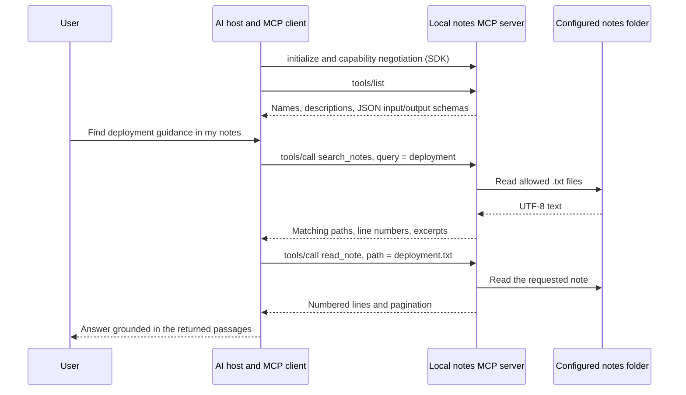
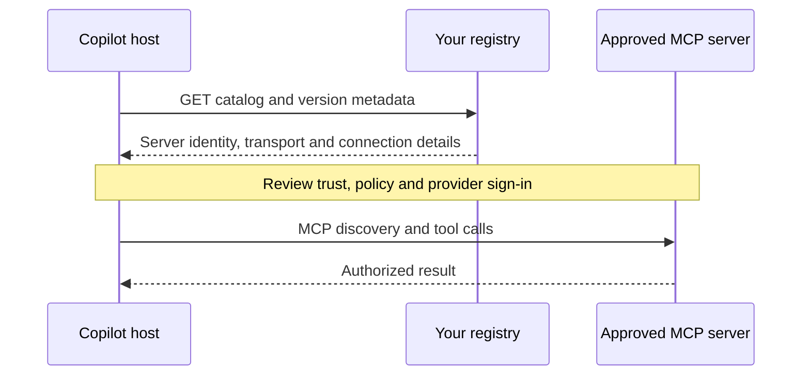
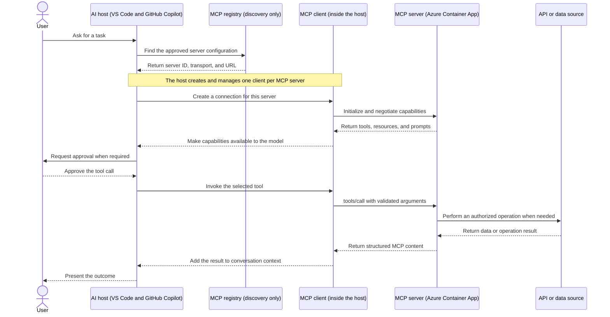

# MCP Starter: GitHub Enterprise and Azure

Learn to use, build, publish, and govern MCP servers. Start with a credential-free SDK lab, run a source-controlled MCP registry locally, then deploy your own registry to Azure and connect it to GitHub Copilot.

The optional two-server workshop connects Microsoft's remote Azure DevOps MCP and a local, read-only Windows OneNote COM MCP. You supply your own organization and approved notebook configuration; this checkout does not require the author's accounts or deployed resources.

1. [Quick start: no cloud account required](#quick-start)
2. [Run and query an MCP registry](#how-to-host-a-registry)
3. [Deploy your registry to Azure](#deploy-this-registry-to-azure)
4. [Configure discovery and policy in GitHub](#how-to-configure-it-in-github)
5. [Connect Azure DevOps and local OneNote](#workshop-demo-azure-devops-and-local-onenote)
6. [Understand MCP and build your own server](#how-mcp-works)
7. [Verify your setup](docs/verification.md)

> [!IMPORTANT]
> The hosted registry and HTTP MCP server are anonymous, read-only demonstrations, not production security templates. They contain no business data or external tool integrations. Azure resources incur charges, and the deployed registry catalog is publicly readable. The separate local notes server reads only its configured folder; do not expose it through the anonymous HTTP service.

## Quick Start

Install **Node.js 22.18+** and **PowerShell 7.2+**, then run from the repository root:

```powershell
git clone https://github.com/melabadi/mcp-starter.git
Set-Location .\mcp-starter
npm ci --ignore-scripts
npm run demo:hello
npm run demo:notes
node .\scripts\smoke.ts --local
```

The Hello World lab launches a real MCP server, discovers `hello`, calls it with `World`, checks the exact greeting, and rejects invalid input. The text-notes lab uses only committed synthetic notes. The smoke check starts temporary loopback registry/HTTP services, runs **5 checks**, and closes them. None of these commands needs Azure, OneNote, Copilot, or a token.

To explore the registry interactively, run `npm run start:registry` and follow the [PowerShell catalog queries](#run-and-query-the-registry-locally). This process serves catalog metadata; it does not start ADO or read OneNote.

## Repository Map

| I want to... | Open |
| --- | --- |
| See every deployment command | [scripts/deploy.ps1](scripts/deploy.ps1) |
| Change identity, ACR, environment, or logging | [infra/main.bicep](infra/main.bicep) |
| Change app resources, ingress, or environment variables | [infra/apps.bicep](infra/apps.bicep) |
| Edit registry entries | [registry/catalog.json](registry/catalog.json) |
| Change registry behavior | [src/registry.ts](src/registry.ts) |
| Add an MCP tool | [src/mcp-server.ts](src/mcp-server.ts) |
| Change service startup or environment handling | [src/main.ts](src/main.ts) |
| Run the server over stdio | [src/stdio.ts](src/stdio.ts) |
| Read local `.txt` notes through MCP | [src/notes-server.ts](src/notes-server.ts) and [src/notes.ts](src/notes.ts) |
| Launch the local notes server | [src/notes-stdio.ts](src/notes-stdio.ts) |
| Read approved OneNote notebooks through MCP | [src/onenote-server.ts](src/onenote-server.ts), [src/onenote.ts](src/onenote.ts), and [src/onenote-auth.ts](src/onenote-auth.ts) |
| Read OneNote desktop locally through COM | [src/onenote-com.ts](src/onenote-com.ts) and [scripts/onenote-com.ps1](scripts/onenote-com.ps1) |
| Configure the CLI and synthetic OneNote notebook | [scripts/setup-onenote-demo.ps1](scripts/setup-onenote-demo.ps1) and [.github/mcp.json](.github/mcp.json) |
| Run Copilot with exactly the two demo MCPs enabled | [scripts/demo.ps1](scripts/demo.ps1) |
| Run the workshop Hello World lab | [examples/hello](examples/hello) |
| See real notes discovery and tool calls | [scripts/notes-demo.ts](scripts/notes-demo.ts) |
| Browse public example notes | [examples/notes](examples/notes) |
| Connect VS Code | [.vscode/mcp.json](.vscode/mcp.json) |
| Verify a deployment | [scripts/smoke.ts](scripts/smoke.ts) |
| Review automated checks | [tests](tests) and [.github/workflows/validate.yml](.github/workflows/validate.yml) |

## Workshop Demo: Azure DevOps and Local OneNote

From the repository root, with Windows OneNote desktop installed:

```powershell
npm ci --ignore-scripts
$AdoOrganization = Read-Host 'Your Azure DevOps organization name (not a project or URL)'
powershell.exe -NoProfile -STA -ExecutionPolicy RemoteSigned `
  -File .\scripts\setup-onenote-demo.ps1 -AdoOrganization $AdoOrganization
npm run demo:hello
npm run demo:onenote
.\scripts\demo.ps1
```

You can also run **MCP Workshop: Copilot CLI** from VS Code's Run Task command; its definition is in [.vscode/tasks.json](.vscode/tasks.json).

> [!IMPORTANT]
> The launcher limits this session to the two workshop MCPs. It does not deploy enterprise policy, grant backend access, or prove that enterprise restrictions are enforced. Complete the [positive and negative client checks](docs/verification.md#5-verify-effective-client-policy) before claiming a rollout is locked down.

The setup script creates only a dedicated **MCP Workshop Demo** notebook under the gitignored local data folder, with one synthetic page. It does not modify existing notebooks. Repeating setup reuses the same fixture. `RemoteSigned` is scoped to the child PowerShell process; no machine or user execution policy is changed, and managed policy still takes precedence.

The committed [.github/mcp.json](.github/mcp.json) uses the organization-neutral `https://mcp.dev.azure.com/` endpoint, with `X-MCP-Readonly: true` and only `core_list_projects`, `wit_work_item`, and `repo_pull_request`. Without an organization in the URL, provide it in tool-call context. The setup command above generates an organization-specific URL instead, which is recommended for the workshop. Complete Microsoft's interactive authentication when offered; no token belongs in this JSON. The organization must be Entra-backed and the account must have appropriate ADO access. See [Microsoft Learn: remote Azure DevOps MCP setup](https://learn.microsoft.com/azure/devops/mcp-server/remote-mcp-server).

Setup generates gitignored local files:

| File | Purpose |
| --- | --- |
| `.mcp.json` | CLI configuration for your ADO organization and the absolute local OneNote entrypoint |
| `.local/onenote-demo.json` | IDs for the synthetic notebook, section and page |
| `.local/managed-settings.json` | Suggested exact URL/command allowlist for administrator review; not automatically deployed |

The local CLI file takes precedence over [.github/mcp.json](.github/mcp.json) and same-named personal definitions. The separate [.vscode/mcp.json](.vscode/mcp.json) prompts for your ADO organization and approved OneNote IDs using VS Code's `servers` wrapper; it is not a CLI configuration. Review generated local configuration before replacing an existing setup.

In the CLI, review `/mcp`, then try:

- **Use azure-devops to list my projects. Do not modify anything.**
- **Use onenote-local to list the approved notebooks, then read the MCP Workshop Demo page.**

[scripts/demo.ps1](scripts/demo.ps1) disables every other configured user/plugin MCP and the built-in MCPs **for this launch only**, without deleting personal settings or granting automatic tool approval. Verify the enabled set without a model call:

```powershell
$configuration = .\scripts\demo.ps1 mcp list --json | ConvertFrom-Json
$configuration.mcpServers.PSObject.Properties |
    Where-Object { $_.Value.enabled } | Select-Object Name
# azure-devops
# onenote-local
```

### Learning Path

| Topic | Runnable example |
| --- | --- |
| 01: Host, client, server and capability boundaries | SDK-only Hello World; OneNote host/client/COM boundary. Tools are implemented; resources/prompts are explained, not falsely advertised as tools. |
| 02: Discovery, schemas, results, errors and transports | `npm run demo:hello`, `npm run demo:onenote`, and `node scripts/smoke.ts --local`; real stdio and HTTP calls, schema errors, structured results, legacy/auto negotiation. |
| 03: REST versus MCP versus CLI | ADO is the provider-hosted adapter; local OneNote uses COM rather than Graph REST. Backend access and MCP discovery remain separate. |
| 04: Connect ADO in Copilot CLI/App | Shared CLI JSON, generated two-server local JSON, read-only headers and provider sign-in. In the App, add the same HTTP endpoint under Customize > MCP; authenticate and inspect tools there separately. |
| 05: Build a server | `hello({name:"World"})` lab plus the four read-only OneNote tools and their access boundaries. |
| 06: Registry and governance | Two-entry catalog, version routes, CORS/write rejection, redeployment and exact URL/command enterprise allowlist. |

The default OneNote adapter uses desktop COM. The [optional Graph backend](#optional-graph-backend-register-and-configure-the-app) demonstrates delegated sign-in instead; these are distinct data-access designs, not interchangeable login settings.

The catalog contains ADO and OneNote by default. It describes OneNote's manual local-checkout installation honestly: there is no published npm package or hosted OneNote endpoint. The standalone Hello World, text-notes and anonymous HTTP labs are not additional approved entries in this two-server workshop.

## Local Text-Notes Demo

This example shows MCP connecting an AI client to a real filesystem. It requires **Node.js 22.18+**, but no Azure subscription, Microsoft sign-in, API key, or native helper. It works with a dedicated notes folder, including one you choose within Documents; it never discovers or hardcodes your home or Documents path.

### Try It Without Private Data

From the repository root in PowerShell:

```powershell
npm ci --ignore-scripts
npm run demo:notes
```

The demo launches the real server as a child process, negotiates MCP using the official TypeScript SDK v2, discovers all three tool schemas, and calls the tools against the committed synthetic notes. It always selects [examples/notes](examples/notes), even if `NOTES_ROOT` is set in your shell. It prints requests and responses, uses no LLM, and closes the server when finished. These are real filesystem reads, not mocked tool responses.

This is a standalone SDK lab, deliberately excluded from the current two-server Copilot configuration and enterprise allowlist. The Windows VS Code configuration selects ADO and OneNote instead. The generic text-notes user-configuration example below is for other deployments, not an instruction to bypass the workshop policy.

### What MCP Does Here



The **host** manages chat, model access, tool approval, and the MCP client connection. The **server** validates tool inputs and performs bounded filesystem reads; it contains no model or summarization logic. The SDK handles MCP initialization, discovery, validation, and transport. With stdio, the host launches `node` and communicates over its stdin/stdout: there is no listening network port, URL, or registry requirement. Server diagnostics go to stderr, not the protocol stream.

| Tool | Example arguments | Result |
| --- | --- | --- |
| `list_notes` | `{"directory":"","offset":0,"limit":20}` | Sorted relative paths, byte sizes, modification times, total count, `nextOffset` |
| `search_notes` | `{"query":"deployment","maxMatches":20}` | Literal matching-line excerpts, relative paths, line numbers, `scannedFiles`, `truncated` |
| `read_note` | `{"path":"deployment.txt","startLine":4,"maxLines":3}` | Numbered text lines, total line count, `nextStartLine` |

Successful tool responses contain both text `content` (JSON readable by the host/model) and matching `structuredContent` validated against an output schema. Validation or filesystem failures return `isError: true` rather than invented results. Use the script output to inspect these actual MCP shapes.

### Select Your Own Notes Folder

`NOTES_ROOT` is the only setting. It must be an **absolute path to an existing folder**. When unset, the server uses the public examples relative to its own source file, independent of the working directory. Empty, relative, missing, or unreadable configured roots fail; they never fall back to another folder.

To select a folder interactively without embedding a machine-specific path in source control:

```powershell
$env:NOTES_ROOT = (Resolve-Path -LiteralPath (Read-Host 'Absolute path to your dedicated text-notes folder')).Path
npm run start:notes
```

`start:notes` waits for an MCP client on stdin; it is not an interactive chat or HTTP server. Use Ctrl+C to stop it. Setting an environment variable in a terminal does not update an already-running VS Code process or override the demo's explicit folder.

For personal use in VS Code, add this server to your **user-level MCP configuration**, replacing the server entrypoint with your own checkout location. Do not commit the personal configuration. VS Code prompts for the notes folder when resolving the configuration:

```json
{
  "servers": {
    "my-txt-notes": {
      "type": "stdio",
      "command": "node",
      "args": ["C:\\path\\to\\mcp-starter\\src\\notes-stdio.ts"],
      "env": {
        "NOTES_ROOT": "${input:notesRoot}"
      }
    }
  },
  "inputs": [
    {
      "id": "notesRoot",
      "type": "promptString",
      "description": "Absolute path to a dedicated folder of UTF-8 .txt notes"
    }
  ]
}
```

The entrypoint path above is a placeholder, not a required location. Other MCP hosts can launch the same Node entrypoint with the same environment variable.

### Boundaries and Privacy

- Read-only `.txt` files, including `.TXT`, in UTF-8 (optional BOM). No write, delete, shell, or arbitrary-file tools. Save UTF-16 notes as UTF-8 first; binary/invalid UTF-8 files are rejected.
- Paths are relative to the configured root. Absolute paths, traversal, Windows device names, and alternate data streams are rejected. Directory scans omit symbolic links and junctions; explicitly reading through one is rejected even when it points inside the root. The configured root itself is resolved once, so a redirected Documents folder can be explicitly selected.
- Each read/search note is limited to **64 KiB**. Listing scans at most **2,000 entries** and **12 nested levels**, with at most **100 notes per page**. Exceeding scan limits is an error, not a partial listing; use `directory` to narrow the scan. Pagination rescans the folder, so changes between calls can change page boundaries.
- Reads return at most **200 lines** per call, with 1-based line numbers. Empty files have zero lines; a trailing newline produces a final empty line. Search is literal, case-insensitive by default (`caseSensitive: true` is available), and returns at most **50 matching lines**, one excerpt of at most **500 characters** per line. `excerptStartColumn` is 1-based; `excerptTruncated` marks shortened lines. Follow up with `read_note` to see full lines. `truncated: true` means the match cap stopped the scan before all lines/files were examined, not that further matches are guaranteed.
- Oversized, unreadable, or invalid UTF-8 notes encountered during search fail that call explicitly; they are not silently skipped. Files beyond an early match cutoff are not read.
- Filenames, matching passages, and requested lines are sent to the connected AI host and may be sent to its model provider. Local execution is **not** a promise that returned data stays on your device. Treat note contents as untrusted data, never as instructions to run commands or disclose more files.
- The server does not persist results or log note contents, and its own error messages omit absolute filesystem paths. The demo script intentionally prints only the public samples. Your host may retain tool results in chat history. Keep personal notes outside this repository and use synthetic notes for demos and screenshots.
- Use a trusted, dedicated folder and normal user permissions. Path checks are not an OS sandbox against another local process maliciously replacing directories while calls run. No private data integration is added to the Azure HTTP service, Docker deployment, or public registry catalog.

## Read OneNote Through MCP

The default OneNote backend is **local Windows desktop COM**, selected by `ONENOTE_BACKEND=com`. The official MCP SDK v2 implements stdio; [src/onenote-com.ts](src/onenote-com.ts) invokes the read-only [PowerShell COM bridge](scripts/onenote-com.ps1). No Graph permission, Entra app registration, client secret, or device-code sign-in is needed for this backend.

Use the setup and `npm run demo:onenote` commands above. To choose another approved synthetic notebook explicitly, configure `ONENOTE_ALLOWED_NOTEBOOK_IDS` as a JSON array of 1-25 COM notebook IDs. COM IDs are not Graph IDs. Do not commit notebook IDs or note contents.

Every call checks the notebook allowlist; section/page membership is verified before reading page content. The bridge only uses `GetHierarchy` and `GetPageContent`. It excludes recycle-bin sections, rejects oversized XML, disables XML external entities, and never requests binary page data. HTML is converted locally to bounded text without fetching images, links, or attachments. Limits are 1 MiB per XML response, 2,000 sections/pages per collection, 100 results per page, 20,000 text characters, and 30 seconds per bridge process. Errors are explicit MCP tool errors, not empty-success notebooks.

OneNote desktop must be installed, registered for COM, and usable in the signed-in interactive Windows session; locked or unavailable notebooks fail visibly. The app can synchronize under its own settings, and the AI host may send returned text to its model provider. A local transport is not an OS sandbox or a guarantee that data stays on the PC. Use the synthetic fixture for demonstrations.

These are documented desktop APIs, not a new cloud authentication flow: [Microsoft Learn: Application interface](https://learn.microsoft.com/office/client-developer/onenote/application-interface-onenote) and [enumerations](https://learn.microsoft.com/office/client-developer/onenote/enumerations-onenote-developer-reference). The setup script's fixture creation is separate from the runtime tools, which remain strictly read-only.

### Optional Graph Backend: Register and Configure the App

Set `ONENOTE_BACKEND=graph` when you need the delegated Microsoft Graph adapter rather than Windows desktop COM. This alternative uses MSAL Node device-code sign-in and Graph's delegated `Notes.Read` permission. Tokens remain in process memory; there is no persisted token cache. It is not connected by the default workshop configuration or deployed to the anonymous Azure service.

1. In Microsoft Entra, register an app for the account type you use. Enable **Allow public client flows**; do not create a client secret.
2. Add the Microsoft Graph **delegated** `Notes.Read` permission and complete any required user or administrator consent.
3. Use Microsoft Graph Explorer, signed in to the intended account with `Notes.Read`, to list notebook IDs using `GET https://graph.microsoft.com/v1.0/me/onenote/notebooks?$select=id,displayName`. Choose only the notebooks this MCP server should expose.
4. Configure the environment variables in a private, user-level MCP configuration. Do not commit notebook IDs or a machine-specific client ID to this repository:

```powershell
$env:ONENOTE_BACKEND = 'graph'
$env:ONENOTE_CLIENT_ID = '00000000-0000-0000-0000-000000000000'
$env:ONENOTE_TENANT_ID = 'organizations'
$env:ONENOTE_ALLOWED_NOTEBOOK_IDS = '["NOTEBOOK-ID-FROM-GRAPH"]'
npm run start:onenote
```

`ONENOTE_TENANT_ID` can be a tenant GUID/domain, `organizations`, or `consumers`. `ONENOTE_ALLOWED_NOTEBOOK_IDS` must be a JSON array containing 1–25 unique IDs. The server lists and reads only those notebooks; a page's notebook membership is checked before its content is requested. Sign-in instructions and device codes are written to stderr, not MCP stdout.

For a VS Code user-level MCP configuration, use this pattern and replace the entrypoint path with the path to your checkout. The prompts keep account-specific settings out of the shared repository configuration:

```json
{
  "servers": {
    "my-onenote": {
      "type": "stdio",
      "command": "node",
      "args": ["C:\\path\\to\\mcp-starter\\src\\onenote-stdio.ts"],
      "env": {
        "ONENOTE_BACKEND": "graph",
        "ONENOTE_CLIENT_ID": "${input:oneNoteClientId}",
        "ONENOTE_TENANT_ID": "${input:oneNoteTenantId}",
        "ONENOTE_ALLOWED_NOTEBOOK_IDS": "${input:oneNoteNotebookIds}"
      }
    }
  },
  "inputs": [
    { "id": "oneNoteClientId", "type": "promptString", "description": "Entra public client ID" },
    { "id": "oneNoteTenantId", "type": "promptString", "description": "Tenant ID/domain, organizations, or consumers" },
    { "id": "oneNoteNotebookIds", "type": "promptString", "description": "JSON array of approved notebook IDs" }
  ]
}
```

For other MCP hosts, launch the same entrypoint with the same environment variables. Keep the environment values in user settings rather than the shared workspace configuration.

### Available Tools and Limits

| Tool | Purpose |
| --- | --- |
| `list_notebooks` | List only the configured allowlisted notebooks. |
| `list_sections` | List sections from one approved notebook, with bounded pagination. |
| `list_pages` | List pages after confirming the section belongs to the approved notebook. |
| `read_page` | Extract bounded plain text from a page after confirming its notebook membership. |

Page HTML is parsed locally; scripts, styles, and external images/links are not executed or fetched. Graph responses are size-limited, pagination URLs are restricted to the expected Graph OneNote route, and throttling/authentication errors are surfaced. Notebook/page text is sent to the connected AI host and may be sent to its model provider; treat it as untrusted data and do not use private notebooks in public demos.

Automated checks exercise the SDK, mocked Graph responses, COM client behavior, and the native PowerShell bridge with a fake desktop object. `npm run demo:onenote` separately verifies all four tools against the actual synthetic desktop notebook, including nonempty expected content and rejected notebook/page/input requests. Graph tests do not perform a live Microsoft sign-in or Graph request.

## How to Host a Registry

### What the Registry Does

An MCP registry is a discovery catalog. It describes approved MCP servers and how clients can connect to them; it does not execute tools or proxy MCP traffic.



### Run and Query the Registry Locally

Start the registry in one terminal:

```powershell
npm run start:registry
# Listening on http://127.0.0.1:3000
```

In a second terminal:

```powershell
$base = 'http://127.0.0.1:3000'
$name = [uri]::EscapeDataString('io.github.melabadi/onenote-local')
Invoke-RestMethod "$base/v0.1/servers?version=latest&limit=10"
Invoke-RestMethod "$base/v0.1/servers/$name/versions/latest"
Invoke-RestMethod "$base/v0.1/servers/$name/versions/1.0.0"
Invoke-RestMethod "$base/v0.1/servers?search=onenote&version=latest"
$response = Invoke-WebRequest "$base/v0.1/servers"
$response.StatusCode
$response.Headers
```

Expect two latest entries: **Azure DevOps (read-only demo)** and **OneNote Local COM (read-only)**, anonymous read/CORS headers, and no credentials. URL-encode the complete server name, including its slash. Follow `metadata.nextCursor` when the catalog spans multiple pages.

The checked-in ADO URL is organization-neutral. To advertise your own organization locally without editing the shared catalog:

```powershell
$AdoOrganization = Read-Host 'Your Azure DevOps organization name'
$env:ADO_MCP_URL = "https://mcp.dev.azure.com/$AdoOrganization"
npm run start:registry
```

The registry only publishes this endpoint's metadata; it does not authenticate to ADO. Stop the process with Ctrl+C. Loopback HTTP is for local learning; [GitHub discovery requires a reachable HTTPS registry](https://docs.github.com/en/copilot/how-tos/administer-copilot/manage-mcp-usage/configure-mcp-registry).

### Registry API Contract

This repository contains a custom, read-only implementation backed by [registry/catalog.json](registry/catalog.json). It is intentionally smaller than the upstream MCP Registry publishing service. GitHub's [official registry guidance](https://docs.github.com/en/copilot/how-tos/administer-copilot/manage-mcp-usage/configure-mcp-registry) requires a self-hosted v0.1 registry to expose these HTTPS routes:

```text
GET /v0.1/servers
GET /v0.1/servers/{url-encoded-server-name}/versions/latest
GET /v0.1/servers/{url-encoded-server-name}/versions/{version}
```

The routes must allow anonymous cross-origin reads so supported Copilot clients can fetch the catalog:

```http
Access-Control-Allow-Origin: *
Access-Control-Allow-Methods: GET, OPTIONS
Access-Control-Allow-Headers: Authorization, Content-Type
```

The implementation also supports version listing, name search, version filtering, `updated_since`, pagination, and `OPTIONS`. Writes return `405 Method Not Allowed`.

> [!NOTE]
> **Azure Container Registry (ACR) is not an MCP registry.** ACR stores container images. The MCP registry is the HTTPS application serving discovery metadata.

### Prerequisites

- Node.js **22.18 or later** and npm.
- PowerShell **7.2 or later** and Azure CLI.
- An enabled Azure subscription.
- Contributor-equivalent access for resource deployment and permission to create role assignments, such as an appropriately scoped Role Based Access Control Administrator role. Owner includes both.
- Permission to register `Microsoft.App`, `Microsoft.ContainerRegistry`, `Microsoft.ManagedIdentity`, and `Microsoft.OperationalInsights` when needed.
- Outbound access to npm, Microsoft Container Registry, and Azure.
- GitHub Enterprise/Copilot entitlement and enterprise-owner access for the later GitHub configuration.

Dependency versions are locked in [package-lock.json](package-lock.json), and Azure Verified Module versions are pinned in [infra/main.bicep](infra/main.bicep) and [infra/apps.bicep](infra/apps.bicep). Local Docker is not required because ACR builds the image in Azure. Neither OneNote nor Copilot is required to deploy the registry.

### Deploy This Registry to Azure

Run all commands from the repository root in PowerShell.

#### 1. Install and Test

```powershell
npm ci --ignore-scripts
npm test
npm run typecheck
```

The tests exercise the registry contract, MCP transports, stdio entrypoint, and deployment script without creating Azure resources.

#### 2. Sign In and Choose Settings

```powershell
az login
az account list --output table
$SubscriptionId = (az account show --query id --output tsv).Trim()
$ResourceGroup = 'rg-mcp-setup-demo'
$Location = 'eastus2'
$BaseName = 'mcp-setup'
$AdoOrganization = Read-Host 'Your Azure DevOps organization name'
$ImageTag = Get-Date -AsUTC -Format 'yyyyMMddHHmmss'
```

Set `$SubscriptionId` explicitly if the active Azure CLI subscription is not the one you intend to use. Never place passwords or tokens in the script.

Register the required resource providers once per subscription. Skip providers that are already registered, and stop if any command fails.

```powershell
az provider register --subscription $SubscriptionId --namespace Microsoft.App --wait
az provider register --subscription $SubscriptionId --namespace Microsoft.ContainerRegistry --wait
az provider register --subscription $SubscriptionId --namespace Microsoft.ManagedIdentity --wait
az provider register --subscription $SubscriptionId --namespace Microsoft.OperationalInsights --wait
```

#### 3. Run the Deployment

[scripts/deploy.ps1](scripts/deploy.ps1) is the executable deployment record. It runs tests, protects against reusing an unrelated resource group, deploys the Bicep infrastructure, builds an image in ACR, resolves its immutable digest, and deploys the two Container Apps. Every failed native command stops the script.

```powershell
.\scripts\deploy.ps1 `
  -SubscriptionId $SubscriptionId `
  -ResourceGroup $ResourceGroup `
  -Location $Location `
  -BaseName $BaseName `
  -AdoOrganization $AdoOrganization `
  -ImageTag $ImageTag
```

The deployment creates:

| Component | Purpose | Implementation |
| --- | --- | --- |
| MCP registry | Serves the read-only v0.1 discovery API | [src/registry.ts](src/registry.ts) and [registry/catalog.json](registry/catalog.json) |
| MCP server | Serves the demo tools over Streamable HTTP | [src/mcp-server.ts](src/mcp-server.ts) |
| Azure Container Registry | Builds and stores the shared image | [infra/main.bicep](infra/main.bicep), Basic SKU, admin account disabled |
| Azure Container Apps | Hosts the registry and server independently | [infra/apps.bicep](infra/apps.bicep), HTTPS ingress, health probes, 0-1 replicas |
| Managed identity | Pulls the image without registry credentials | ACR-scoped `AcrPull` assignment |
| Log Analytics | Collects Container Apps logs | 30-day retention and 0.1 GB daily ingestion cap |

The same immutable image runs both applications. `SERVICE` selects the process; `ADO_MCP_URL` selects the provider endpoint using your required `AdoOrganization` parameter. There is no author-specific organization default in Bicep or the deployment script. The anonymous HTTP hosting example is deliberately not in the approved catalog. OneNote stays on the PC and is never added to the Azure HTTP service.

The script writes non-secret endpoints, including `adoMcpUrl`, to the gitignored `.azure/deployment.json` file and prints values similar to:

```text
GitHub registry base URL: https://YOUR-REGISTRY.azurecontainerapps.io
MCP server URL: https://YOUR-SERVER.azurecontainerapps.io/mcp
```

#### 4. Verify Before Using the Registry

```powershell
node .\scripts\smoke.ts
```

From another machine, pass the endpoints explicitly:

```powershell
node .\scripts\smoke.ts `
  --registry https://YOUR-REGISTRY.azurecontainerapps.io `
  --server https://YOUR-SERVER.azurecontainerapps.io/mcp `
  --ado-url "https://mcp.dev.azure.com/$AdoOrganization"
```

The smoke test checks registry list and version routes against the source catalog with the configured ADO URL, follows catalog pagination, then checks CORS, rejected writes, server health, Origin validation, SDK tool discovery, tool calls, and invalid inputs. When run without endpoint arguments it uses `.azure/deployment.json`; an older deployment record may need `--ado-url` explicitly. Wait for revision routing to settle and rerun if a Container App has just been deployed. An ARM success alone does not prove the application is ready.

Expected result: **5/5 checks passed**.

Use the [verification checklist](docs/verification.md) to record your own results. Do not copy deployment addresses or account identifiers from screenshots or previous deployments.

### Add, Update, and Remove Catalog Entries

1. Edit [registry/catalog.json](registry/catalog.json) through a reviewed change.
2. Use a reverse-DNS server name such as `com.example/my-server`. Use a namespace you control for a real publication.
3. Advertise a real remote HTTPS endpoint or an actually published, pinned package. A local checkout may have a metadata-only entry with explicit setup instructions, as OneNote does here; it is not a one-click package installation. Never invent an npm package or put credentials/local notebook IDs in catalog values.
4. Keep each name/version pair unique and exactly one version per server marked `isLatest: true`.
5. Update [tests/registry.test.ts](tests/registry.test.ts) and [tests/demo.test.ts](tests/demo.test.ts) when intentionally changing this starter's two-server example. The smoke check compares the live service to your source catalog rather than a hardcoded server count.
6. Run `npm test`, `npm run typecheck`, deploy a fresh image tag, and rerun the smoke test before changing enterprise policy.

For example, append an entry like this **only after replacing the example namespace and endpoint with one you control**:

```json
{
  "server": {
    "$schema": "https://static.modelcontextprotocol.io/schemas/2025-12-11/server.schema.json",
    "name": "com.example/team-tools",
    "title": "Team Tools",
    "description": "Read-only tools for a team-owned service.",
    "version": "1.0.0",
    "remotes": [
      { "type": "streamable-http", "url": "https://YOUR-SERVICE.example.com/mcp" }
    ]
  },
  "_meta": {
    "io.modelcontextprotocol.registry/official": {
      "status": "active",
      "publishedAt": "2026-11-02T00:00:00Z",
      "updatedAt": "2026-11-02T00:00:00Z",
      "isLatest": true
    }
  }
}
```

To publish a new version, retain the previous entry, add the new name/version pair, mark only the new entry latest, and update its timestamp. Clients using a pinned version can still retrieve the older metadata. To remove an approval, review dependent clients and runtime policy as well as removing the catalog entry; editing discovery metadata is not revocation of backend access.

Catalog changes take effect when the image is redeployed. GitHub's configured registry URL does not change when the Container App address remains the same.

The ADO override is implemented by `loadRegistryCatalog()` in [src/registry.ts](src/registry.ts), shared with the smoke check. If you rename the starter's ADO identity, update that lookup and its tests. Keep client headers and advertised catalog headers consistent. The local OneNote entry describes manual checkout installation and intentionally has no fictitious package or localhost HTTP endpoint.

For a managed alternative, GitHub documents [Azure API Center as an MCP registry](https://docs.github.com/en/copilot/how-tos/administer-copilot/manage-mcp-usage/configure-mcp-registry#option-2-using-azure-api-center-as-an-mcp-registry). This walkthrough deliberately hosts the registry as application code.

### Update, Roll Back, and Remove

Use a fresh image tag for every release:

```powershell
.\scripts\deploy.ps1 -SubscriptionId $SubscriptionId `
  -ResourceGroup $ResourceGroup -Location $Location -BaseName $BaseName `
  -AdoOrganization $AdoOrganization `
  -ImageTag (Get-Date -AsUTC -Format 'yyyyMMddHHmmss')
node scripts/smoke.ts
```

For an application rollback, resolve a previously verified image tag to its digest and redeploy [infra/apps.bicep](infra/apps.bicep) with that digest and the same required `adoOrganization` parameter. Do **not** run `az acr build` with an old tag because that overwrites the old image. Infrastructure rollback requires a reviewed Bicep change.

Before deleting the registry, move GitHub to another working registry or deliberately revise the access policy. Deleting an active registry while leaving **Registry only** enabled breaks discovery.

```powershell
az group delete --subscription $SubscriptionId --name $ResourceGroup
```

This removes the tutorial apps, Container Apps environment, ACR, Log Analytics workspace, and managed identity. Review soft-delete behavior and Azure Cost Management afterward.

### Registry Troubleshooting

| Symptom | Check |
| --- | --- |
| GitHub cannot discover the registry | Use the base URL, verify all three v0.1 routes anonymously, and check CORS. A static raw JSON URL is insufficient. |
| Latest-version route returns 404 | URL-encode the slash in the server name and confirm the latest Container App revision is receiving traffic. |
| ACR image pull fails | Check the user-assigned identity, `AcrPull` role assignment, and digest-pinned image in the Bicep files. Do not enable ACR admin credentials as a workaround. |
| Azure returns 403 for public access | Verify public access on the Container Apps environment and external ingress on both apps. |
| ACR Basic reports `NetworkRuleNotSupported` | Basic cannot use Premium network rules. The template uses public networking while retaining authenticated image pulls. |

Useful diagnostics:

```powershell
az deployment group show --subscription $SubscriptionId --resource-group $ResourceGroup --name "$BaseName-apps" --query properties.provisioningState
az resource show --subscription $SubscriptionId --resource-group $ResourceGroup --resource-type Microsoft.App/containerApps --name "$BaseName-server" --api-version 2025-01-01 --query properties.latestReadyRevisionName
az containerapp logs show --subscription $SubscriptionId --resource-group $ResourceGroup --name "$BaseName-server" --type console --tail 50
```

## How to Configure It in GitHub

### Configure the Enterprise Registry

GitHub recommends [enterprise managed allowlists](https://docs.github.com/en/copilot/how-tos/administer-copilot/manage-mcp-usage/configure-enterprise-allowlist) for execution controls. Registry-based restriction is a separate preview mechanism; a two-entry catalog alone is not proof that other runtime servers are blocked.

Setup generates the gitignored `.local/managed-settings.json` with exactly two identity rules: the ADO organization URL and `["node","ABSOLUTE-CHECKOUT-PATH\\src\\onenote-stdio.ts"]`. Merge `allowedMcpServers` into the designated enterprise governance repository's `copilot/managed-settings.json`, preserving its existing model, centrally managed plugins, marketplaces, and other policies. Do not use a user-chosen `serverName` as an identity check or allow every `node` command. The concrete path intentionally authorizes only this demo installation; other installations need reviewed exact commands.

For example, the generated policy has this shape; replace both placeholders before deploying it:

```json
{
  "allowedMcpServers": [
    { "serverUrl": "https://mcp.dev.azure.com/YOUR-ORGANIZATION" },
    { "serverCommand": ["node", "C:\\YOUR-CHECKOUT\\src\\onenote-stdio.ts"] }
  ]
}
```

In the enterprise's designated `.github-private` repository, merge these rules into `copilot/managed-settings.json` and publish through your normal review process. This starter never writes enterprise settings for you. Restart/refresh supported clients and verify approved connections **and** a blocked, harmless unapproved server before declaring enforcement. See [the policy verification checklist](docs/verification.md#5-verify-effective-client-policy).

Documented limitations: only supported clients receiving the enterprise's Copilot seat and managed settings enforce this policy; multiple sources intersect allowlists, and deny rules take precedence. First-party default MCPs are exempt from these enterprise lists. The demo launcher disables those defaults and all other configured servers locally to achieve exactly two enabled MCPs for the presentation. Managed settings are not an OS sandbox or authorization to ADO/OneNote data.

For discovery and the legacy policy migration:

1. Open **your enterprise > AI Controls > MCP**. On GHE.com, use the enterprise's own hostname.
2. Record the existing registry URL and policy. If **Registry only** is enabled, migrate approved entries before replacing the URL.
3. Set **MCP servers in Copilot** to **Enabled everywhere**. Leave unrelated enterprise policies unchanged.
4. Enter the **registry base URL** printed by the deployment script in **MCP Registry URL**, then select **Save**.
5. After validating delivery of the managed allowlist, select **Allow all** for the old registry restriction to avoid conflicting execution policies. Keep the two-entry registry URL for discovery. Do not remove the old restriction before the replacement policy is available.
6. Reload the page and verify that the URL and policy persisted.

> [!WARNING]
> Enter the registry base URL, not `/v0.1/servers`, `/mcp`, an ACR URL, or a raw JSON URL. GitHub appends the v0.1 routes. Never place a personal access token or another credential in the URL.

### Understand the Policy Boundary

Registry-based restriction is currently a **public preview**. GitHub states that the more secure, generally available enforcement method is an enterprise [`managed-settings.json` MCP allowlist](https://docs.github.com/en/copilot/how-tos/administer-copilot/manage-mcp-usage/configure-enterprise-allowlist). A registry is still useful for discovery and curation, but it is not a substitute for authentication and authorization on each MCP server.

An organization owner can configure a registry under **Organization Settings > Copilot > Policies** where enterprise policy permits it. Enterprise policy takes precedence and may hide or disable organization controls. Policy also follows the organization or enterprise supplying the user's Copilot Business or Enterprise seat; it does not govern personal Copilot plans.

Supported surfaces and enforcement behavior change over time. Check GitHub's [MCP private registry enforcement reference](https://docs.github.com/en/copilot/reference/enterprise-administrators/mcp-private-registry-enforcement) before rollout. Do not assume an enterprise registry configures Copilot cloud agent or every other Copilot surface in the same way.

### Verify in VS Code

The workspace's [.vscode/mcp.json](.vscode/mcp.json) contains only remote **azure-devops** and stdio **onenote-local**. Enter your own ADO organization when prompted. For OneNote, supply the JSON array containing the synthetic `notebookId` from your generated `.local/onenote-demo.json`. Keep those local values out of shared configuration.

In VS Code:

1. Sign into the account whose Copilot seat comes from the configured enterprise.
2. Open the Extensions view and search for `@mcp`, or run **MCP: List Servers**.
3. Review the server configuration and trust prompt before starting it.
4. Start **onenote-local**, select its tools, and ask: **List the approved notebooks, then read the MCP Workshop Demo page.** Start ADO separately and complete its provider sign-in.

Expected result:

```text
One approved notebook: MCP Workshop Demo
The page contains: MCP_WORKSHOP_PUBLIC_FIXTURE_V1
```

Microsoft's [VS Code MCP documentation](https://code.visualstudio.com/docs/agent-customization/mcp-servers) distinguishes workspace and profile configuration and warns that local MCP servers can run arbitrary code. Only start servers from trusted sources and inspect their configuration first.

Registry gallery visibility proves discovery only, not installation, startup, or tool invocation. For failures, use **MCP: List Servers > Show Output** and check the selected account, policy refresh, trust state, and enabled tools.

## How MCP Works

### Open Standard and Governance

The Model Context Protocol is an open standard for connecting AI applications to external tools and context. In December 2025, MCP became a founding project of the Linux Foundation's [Agentic AI Foundation](https://www.linuxfoundation.org/press/linux-foundation-announces-the-formation-of-the-agentic-ai-foundation), giving the project a neutral, community-driven governance home. GitHub likewise describes MCP as a standard way to extend Copilot with external systems in its [MCP overview](https://docs.github.com/en/copilot/concepts/context/mcp).

MCP standardizes the exchange between an AI application and a server. It does not prescribe which model the host uses, how the host builds its prompt, or whether a tool invocation should be approved.

### Host, Client, and Server

The [official MCP architecture](https://modelcontextprotocol.io/docs/learn/architecture) defines three participants:

| Participant | Responsibility | Example here |
| --- | --- | --- |
| Host | Coordinates the AI experience and manages MCP clients | VS Code with GitHub Copilot |
| Client | Maintains one connection to one MCP server | The MCP client created by VS Code |
| Server | Publishes capabilities and handles requests | The Container App running [src/mcp-server.ts](src/mcp-server.ts) |

A host creates a separate MCP client for each server. The registry is outside that protocol connection: it helps the host discover and approve server configurations, after which the client talks directly to the selected MCP server.



### Protocol Layers and Capabilities

MCP separates a JSON-RPC-based data layer from its transport layer. The official SDK implements those details so applications do not need a hand-written JSON-RPC handshake.

Servers can expose three core primitives:

| Primitive | Purpose | Example |
| --- | --- | --- |
| Tools | Executable functions the host can invoke | `greet`, `deployment_checklist` |
| Resources | Context the host can read | File content, database records, API responses |
| Prompts | Reusable interaction templates | A structured diagnostic workflow |

This demo exposes tools only. A client discovers the available tools and their JSON schemas, the model can propose a call, and the host sends the validated request to the server. The result returns to the host as conversation context.

MCP currently defines two primary transports:

| Transport | Typical use | This repository |
| --- | --- | --- |
| stdio | A host starts a local process and communicates through standard input/output | [src/stdio.ts](src/stdio.ts) |
| Streamable HTTP | One remote HTTPS service handles multiple clients | `/mcp` in [src/mcp-server.ts](src/mcp-server.ts) |

The request flow is:

1. The host obtains a server configuration directly or from a registry.
2. The host creates an MCP client and discovers the server's supported protocol version and capabilities.
3. The client lists tools, resources, or prompts exposed by that server.
4. When the host chooses a tool, the client sends its name and schema-validated arguments to the server.
5. The server performs the operation and returns structured content to the host.

MCP interoperability does not remove security boundaries. The host must establish trust and user approval; the server must authenticate users, authorize each operation, validate input, protect downstream credentials, and log safely.

## How to Deploy Your Own MCP Server

### Start with the Demo Server

[src/mcp-server.ts](src/mcp-server.ts) uses the official MCP TypeScript SDK v2. `buildMcpServer()` registers tools with Zod input/output schemas and behavioral annotations. `createMcpHandler()` and `toNodeHandler()` provide protocol and Streamable HTTP handling. [src/stdio.ts](src/stdio.ts) exposes the same tools locally over stdio.

The included tools are deliberately read-only:

| Tool | Input | Result |
| --- | --- | --- |
| `greet` | `name`: nonempty string, at most 80 characters | Connectivity greeting |
| `deployment_checklist` | `component`: `registry` or `server` | Static deployment guidance |

Run the complete local checks:

```powershell
npm ci --ignore-scripts
npm test
npm run typecheck
node scripts/smoke.ts --local
```

For a persistent local server:

```powershell
npm start
```

The Streamable HTTP endpoint is `http://127.0.0.1:3001/mcp`; health is available at `http://127.0.0.1:3001/healthz`. Run `npm run start:stdio` to use stdio instead.

### Add Your Tool

1. Register the tool in `buildMcpServer()` with a clear name, description, input schema, output schema, and accurate annotations.
2. Keep credentials and private data out of source, tool descriptions, catalog entries, logs, and test snapshots.
3. Add behavior and validation coverage in [tests/server.test.ts](tests/server.test.ts).
4. Run `npm test`, `npm run typecheck`, and the local smoke test.
5. Update the catalog metadata if the server identity, version, or endpoint changes.

Annotations such as `readOnlyHint` describe behavior to clients; they do not enforce authorization. A tool that reads private data still requires authentication and per-user authorization.

### Configure the Runtime

Environment handling is centralized in [src/main.ts](src/main.ts):

| Variable | Purpose |
| --- | --- |
| `SERVICE` | Selects `server` or `registry`; the same image supports both |
| `HOST`, `PORT` | Control the bind address; local defaults are loopback-only |
| `ADO_MCP_URL` | Approved `https://mcp.dev.azure.com/ORGANIZATION` URL; required for a publicly bound registry |
| `ALLOWED_HOSTS` | Adds comma-separated hostnames accepted by Host validation |
| `ALLOWED_ORIGIN_HOSTS` | Controls accepted browser Origin hostnames |
| `CONTAINER_APP_HOSTNAME` | Adds the Azure-provided hostname to Host validation |

Remote catalog URLs must use HTTPS and must not contain credentials. Host and Origin checks reduce cross-site and DNS-rebinding risk; they are not user authentication.

### Deploy the Server

For the first deployment, follow [Deploy This Registry to Azure](#deploy-this-registry-to-azure). The repository deploys the registry and standalone HTTP server together, but the current catalog approves only ADO and local OneNote.

After changing a tool, redeploy with a fresh image tag:

```powershell
$ImageTag = Get-Date -AsUTC -Format 'yyyyMMddHHmmss'
.\scripts\deploy.ps1 `
  -SubscriptionId $SubscriptionId `
  -ResourceGroup $ResourceGroup `
  -Location $Location `
  -BaseName $BaseName `
  -AdoOrganization $AdoOrganization `
  -ImageTag $ImageTag
node scripts/smoke.ts
```

The deployment uses ACR cloud build and pins the Container Apps revision to the resulting image digest. The container runs as the non-root `node` user. The server has 0.25 CPU, 0.5 GiB memory, health probes, HTTPS-only ingress, and a maximum of one replica.

### Production Controls

- Require MCP-compatible OAuth for private data or actions. Validate issuer, audience, scopes, and per-tool authorization.
- Use least-privilege identities for downstream systems. The tutorial identity can only pull its image from ACR.
- Add rate limits, request-size limits, abuse monitoring, redacted audit logs, and budget alerts.
- Review network isolation, private endpoints, availability targets, replica limits, and cold-start tolerance.
- Scan npm and OS/container dependencies, pin reviewed versions, and establish a patching process.
- Keep tool schemas narrow, minimize enabled capabilities, and require confirmation for consequential actions.
- Test discovery, valid and invalid calls, authentication failures, authorization boundaries, cancellation, and timeouts before release.

ACR Basic has a standing charge. ACR builds, Container Apps usage beyond included grants, logs, retention, and network transfer can also incur charges. Scale-to-zero does not make the full deployment free. Check [Azure pricing](https://azure.microsoft.com/pricing/) for the target subscription and region.

### Server Troubleshooting

| Symptom | Check |
| --- | --- |
| `GET /mcp` does not look healthy | Use `/healthz`; `/mcp` is a protocol endpoint and should be tested with the SDK smoke test. |
| SDK rejects Host or Origin | Check the runtime hostname variables and SDK guards. Do not disable validation globally. |
| VS Code shows no tools | Check server trust, enabled tools, selected GitHub account, enterprise policy, and **MCP: List Servers > Show Output**. |
| A local server is blocked | Check the exact command and every argument in the effective managed allowlist, selected enterprise account, policy refresh, and any remaining legacy registry restriction. Do not rename a server to bypass policy. |
| A new revision is not serving | Inspect `latestReadyRevisionName`, Container App logs, and traffic routing, then rerun the smoke test. |

## Official Sources

- [Linux Foundation: Formation of the Agentic AI Foundation and MCP contribution](https://www.linuxfoundation.org/press/linux-foundation-announces-the-formation-of-the-agentic-ai-foundation)
- [MCP: Architecture overview](https://modelcontextprotocol.io/docs/learn/architecture)
- [MCP protocol specification](https://modelcontextprotocol.io/specification/latest)
- [Official MCP TypeScript SDK v2](https://ts.sdk.modelcontextprotocol.io/v2/)
- [Official MCP Registry API](https://registry.modelcontextprotocol.io/docs)
- [GitHub: About Model Context Protocol](https://docs.github.com/en/copilot/concepts/context/mcp)
- [GitHub: Configure an MCP registry](https://docs.github.com/en/copilot/how-tos/administer-copilot/manage-mcp-usage/configure-mcp-registry)
- [GitHub: Restrict access based on a registry](https://docs.github.com/en/copilot/how-tos/administer-copilot/manage-mcp-usage/restrict-based-on-registry)
- [GitHub: MCP private registry enforcement](https://docs.github.com/en/copilot/reference/enterprise-administrators/mcp-private-registry-enforcement)
- [Microsoft VS Code: Add and manage MCP servers](https://code.visualstudio.com/docs/agent-customization/mcp-servers)
- [Microsoft Learn: Register and discover remote MCP servers in Azure API Center](https://learn.microsoft.com/azure/api-center/register-discover-mcp-server)
- [Azure Verified Modules](https://azure.github.io/Azure-Verified-Modules/)
